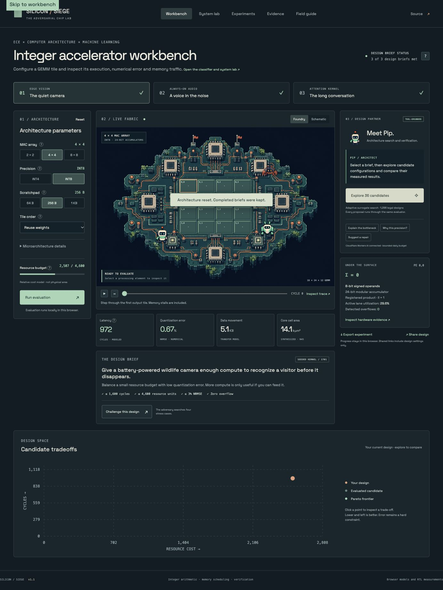
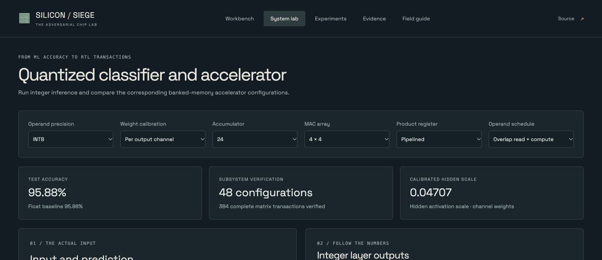

# Silicon Siege

[Live lab](https://silicon-siege.pages.dev/) · [System lab](https://silicon-siege.pages.dev/#/lab)

Silicon Siege is an interactive integer-accelerator design lab. It connects quantized neural-network inference, parameterized GEMM hardware, cycle traces, architecture search and physical-design measurements. The interface includes a pixel-art array view and a schematic view.



## System lab

The System lab runs a trained 64→32→10 digit classifier with static INT4 or INT8 quantization. Controls expose weight scaling, accumulator width, array size, product registers and operand scheduling. Pixel edits rerun inference locally; exact integer tensors and inference traces are exportable.

A synthesizable subsystem provides synchronous operand banks, command handling, tiled execution, indexed results, backpressure and performance counters. A constrained selector evaluates 96 configurations using validation accuracy, MAC-tile synthesis area and RTL-checked cycle counts.



## Results

| Experiment | Result |
| --- | --- |
| Subsystem simulation | 48 configurations, 384 complete GEMMs checked against an independent Python oracle; representative synthesized-netlist replay |
| Integer inference parity | 21,564 held-out predictions match between NumPy and JavaScript across 12 configurations |
| Classifier accuracy | 95.882% floating point; 95.882% INT8/channel/ACC24; 95.715% INT4/channel/ACC16 |
| Operand scheduling | 817 active clocks with overlapped reads versus 1,414 serialized, for a four-example two-layer workload |
| Cold-load accounting | 3,571 versus 4,168 interface clocks including operand loads and command acceptance; host postprocessing excluded |
| Tile verification | 36 configurations, 49,344 differential clock edges, two detected mutations and bounded protocol checks |
| Arithmetic refinement | Four unbounded single-lane induction proofs covering INT4/INT8 and direct/registered products |
| Routed pipeline comparison | Both tiles meet the same 2 ns Nangate45 target; registered products improve setup margin with 10.3% more routed cell area |
| Search comparison | On three fixed synthetic kernels and 20 paired seeds, the fixed heuristic has lower mean regret than the adaptive RBF method |

Routed measurements cover the MAC tile. The controller and inferred memories have synthesis and simulation evidence, but are excluded from the physical area and timing results. Nangate45 is an academic technology library. Full methodology and scope are in [system architecture and measurements](docs/MEASUREMENTS.md).

## Workbench

The Workbench evaluates synthetic GEMM workloads with a streaming output-stationary tile and a host/cache/transfer model. It includes cycle playback, individual processing-element inspection, numerical error maps, stress cases, proposal comparison, a Pareto plot, seeded search experiments, design links and JSON export. The three design briefs use cycle, numerical-error and resource constraints.

The optional cloud mentor selects a bounded strategy or configuration through Cloudflare Workers AI. The browser evaluates each proposed configuration before it is applied. Local simulation and search work without cloud inference.

## Run locally

Requires Node 22+ and Python 3 for the independent-oracle test. There are no npm dependencies or local build step.

```sh
npm run dev           # http://127.0.0.1:4173
npm test              # numerical, controller, selector and API checks
npm run experiments   # original five-seed search comparison
npm run audit-search  # 20-seed comparison with exhaustive reference optima
```

The local static server disables cloud mentor calls. EDA and model training run on GitHub-hosted runners.

## Documentation

- [System architecture and measurements](docs/MEASUREMENTS.md)
- [Browser model and API contracts](docs/ARCHITECTURE.md)
- [Research and search experiments](docs/RESEARCH.md)
- [Release validation](docs/VALIDATION.md)
- [Assets and attribution](docs/ASSETS.md)

## Reproduce hardware measurements

```sh
gh workflow run hardware.yml
gh workflow run physical.yml
gh workflow run depth.yml
gh workflow run timing.yml
```

The workflows record tool versions, source commits and input hashes. The OpenROAD container is pinned by digest. Import scripts in `scripts/` validate and copy completed artifacts into `web/evidence/`.

## Deploy to Cloudflare

Upload the contents of `web/` as a Pages direct-upload ZIP. `_routes.json` invokes the advanced-mode Worker only for `/api/*`.

Bind Workers AI as `AI` and a dedicated D1 database as `BUDGET`. The Worker initializes its quota table automatically and fails closed when either binding is unavailable. Atomic counters limit mentor attempts to eight per source IP per day and 64 globally per day. The application stores daily IP hashes and counters; it does not persist raw IPs or prompts. Local tools remain available after quota exhaustion.

## Source layout

| Path | Contents |
| --- | --- |
| `web/` | Interface, browser models and Cloudflare Worker |
| `web/evidence/` | Measurements, reports, model data and layout artifacts |
| `rtl/` | Compute tile, subsystem, formal harness and physical constraints |
| `scripts/` | Training, verification, experiments and artifact import |
| `tests/` | Browser-model, independent-oracle and API tests |
| `docs/` | Contracts, methodology and validation records |
